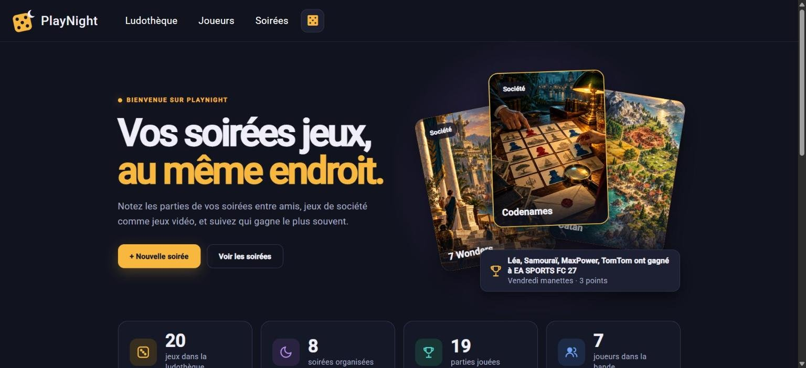
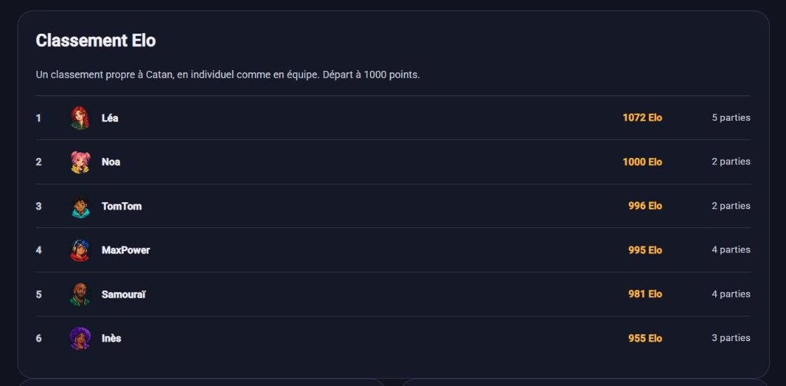
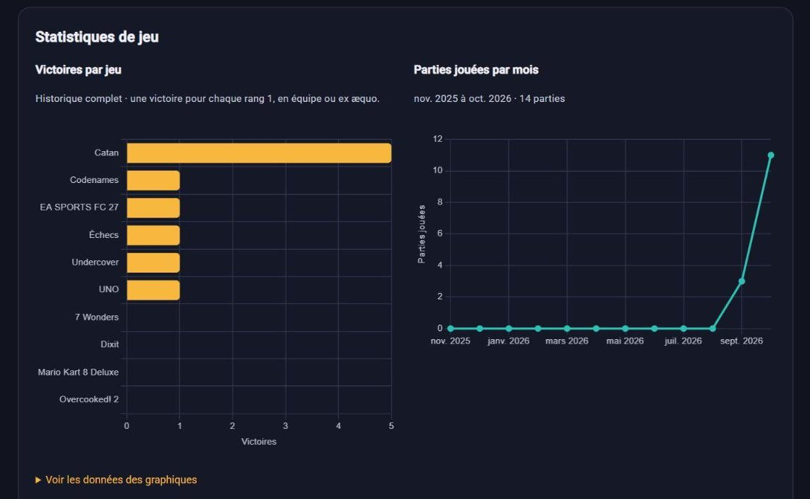
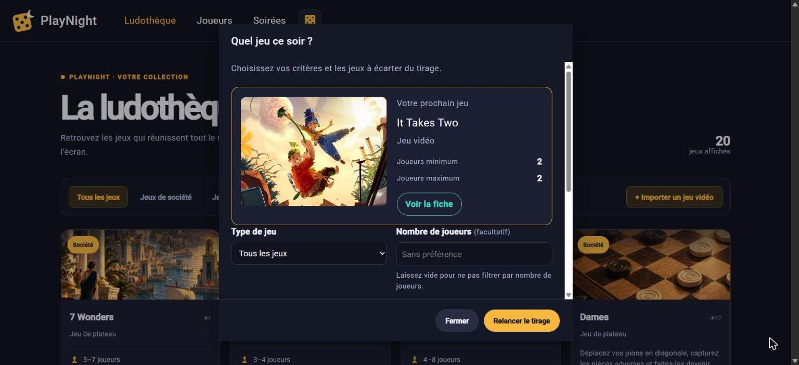

# PlayNight

[](https://github.com/Will-emma/playnight/actions/workflows/ci.yml)

Application web de suivi de soirées jeux entre amis, pour les jeux de société comme pour les jeux vidéo.
PlayNight enregistre les soirées, les parties jouées et les scores, puis en tire un historique et des statistiques par joueur et par jeu.

> Projet scolaire réalisé en binôme, rendu le 31 octobre 2026.



## Fonctionnalités

**Socle**

- Ludothèque : jeux de société et jeux vidéo, filtre par type, fiche détaillée de chaque jeu
- Joueurs : liste classée, profil avec parties jouées, victoires, taux de victoire et historique
- Soirées : création d'une soirée (joueurs présents, parties jouées, scores, y compris en équipe ou ex æquo), liste et détail
- Suppression d'une soirée, d'un joueur ou d'un jeu depuis l'application ; un jeu déjà joué reste protégé
- Accueil : chiffres clés, podium des champions, dernière soirée

**Bonus**

- Classement Elo par jeu, Elo global et courbe de progression de chaque joueur (page « Règles Elo » dans l'application)
- Classement par victoires sur chaque fiche jeu, avec une page dédiée
- Graphiques sur le profil joueur : victoires par jeu et parties jouées par mois (ng2-charts)
- Import de jeux vidéo depuis l'API RAWG, avec leur image
- Avatars : galerie de portraits PlayNight ou photo importée
- Tirage au sort « Quel jeu ce soir ? » (icône 🎲) : filtres par type et nombre de joueurs, jeux à exclure

| Fiche jeu : classement Elo | Profil joueur : statistiques | Tirage au sort |
|---|---|---|
|  |  |  |

## Stack technique

| Partie | Technologies |
|---|---|
| Backend | Java 17, Spring Boot 3.1, Spring Data JPA, Swagger (springdoc-openapi) |
| Frontend | Angular 17, Angular Material, Bootstrap 5, Chart.js (ng2-charts) |
| Base de données | PostgreSQL, lancée avec Docker Compose |

## Prérequis

- [Docker Desktop](https://www.docker.com/products/docker-desktop/), lancé
- Java 17 (JDK) et [Maven](https://maven.apache.org/download.cgi) 3.9 ou plus
- [Node.js](https://nodejs.org/) 20 LTS (recommandé) et npm

## Installation

À faire une seule fois, depuis la racine du projet :

```bash
cd back-skeleton
cp .env.sample .env
```

Ouvrir ensuite `back-skeleton/.env` et renseigner les identifiants de la base locale :

```properties
DATABASE_USER=playnight
DATABASE_PASSWORD=playnight
DATABASE_NAME=playnight
```

Le fichier `.env` reste sur votre machine : il est exclu de Git.

Facultatif : pour importer des jeux vidéo depuis RAWG (bonus), créer une clé gratuite sur [rawg.io/apidocs](https://rawg.io/apidocs) et l'ajouter dans le même fichier :

```properties
RAWG_API_KEY=votre_clé
```

Sans cette clé, l'appli fonctionne normalement ; seul l'import RAWG est indisponible.

## Lancement

Le projet se lance dans **deux terminaux**, ouverts depuis la racine du projet et laissés ouverts pendant le développement.

**Terminal 1 : base de données et backend**

```bash
cd back-skeleton
docker compose up -d
mvn spring-boot:run
```

Le backend est prêt quand la ligne `Started BackSkeletonApplication` s'affiche. Il lit automatiquement le fichier `.env`.
Dans IntelliJ, il suffit de lancer la classe `BackSkeletonApplication` : le plugin EnvFile n'est plus nécessaire.

**Terminal 2 : frontend**

```bash
cd front-skeleton
npm install
npm start
```

Le frontend est prêt quand `Compiled successfully` s'affiche. `npm install` n'est nécessaire qu'au premier lancement ou après un changement de dépendances.

**Arrêt** : `Ctrl + C` dans chaque terminal, puis `docker compose down` dans `back-skeleton/` pour arrêter la base.

| Service | Adresse |
|---|---|
| Application | http://localhost:4200 |
| API REST | http://localhost:8080 |
| Documentation de l'API (Swagger UI) | http://localhost:8080/swagger-ui/index.html |

## Données de démo

Au premier `docker compose up`, la base est créée avec des données d'exemple (scripts de `back-skeleton/initdb/`) : l'application est remplie dès son ouverture.

| Joueurs | Jeux | Soirées | Parties |
|---|---|---|---|
| 7 | 20 (8 jeux de société, 12 jeux vidéo) | 8, de septembre à octobre 2026 | 19 |

Les classements Elo sont calculés par le backend à son démarrage. Les images des jeux vidéo viennent de RAWG et nécessitent une connexion Internet ; sans connexion, chaque jeu s'affiche avec une couleur et son initiale. Aucune clé RAWG n'est nécessaire pour les afficher.

## Règles de calcul

- **Victoire** : chaque rang 1 compte une victoire, y compris en équipe ou ex æquo. Les points ne servent qu'à l'affichage du score.
- **Classement des joueurs** (accueil et page Joueurs) : le plus de victoires d'abord, puis le plus de parties jouées, puis le pseudo.
- **Classement par victoires d'un jeu** : nombre de victoires à ce jeu ; à égalité, les joueurs partagent la même place.
- **Elo par jeu** : chaque joueur part de 1000 points pour chaque jeu, avec un coefficient K = 32. En individuel à plusieurs, chaque joueur est comparé à tous les autres ; en équipe, chaque équipe compte avec la moyenne des Elo de ses membres, qui reçoivent tous la même variation. Le détail est expliqué dans la page « Règles Elo » de l'application.
- **Elo global** : moyenne des Elo par jeu d'un joueur, chaque jeu comptant à parts égales. Il mesure la réussite plutôt que le volume : dans les données de démo, Weedy (2 victoires sur 2 parties) est premier au classement global, alors que Léa a le plus de victoires.

## Limites connues

- La fiche d'un jeu et le profil d'un joueur affichent les parties, mais pas de lien vers la soirée correspondante : l'API ne renvoie pas la soirée d'une partie sur ces pages.
- La liste des soirées et le podium de l'accueil font une requête par soirée ou par joueur : suffisant pour une bande d'amis, à regrouper pour de gros volumes.
- Les classements Elo sont recalculés au démarrage du backend et après chaque modification de soirée, à partir de tout l'historique.

## Structure du projet

```
├── back-skeleton/       API Spring Boot
│   ├── initdb/          scripts SQL exécutés à la création de la base
│   └── src/main/java/   controllers → services → DAO → models, DTO
├── front-skeleton/      application Angular
├── docs/                documentation de conception
└── .github/workflows/   intégration continue (GitHub Actions)
```

## Contribuer

La branche `main` est protégée : toute modification passe par une Pull Request.

1. Partir d'une version à jour : `git checkout main` puis `git pull`
2. Créer une branche pour le ticket : `git checkout -b feature/nom-du-ticket`
3. Committer, pousser la branche, puis ouvrir une Pull Request contenant `Closes #<numéro du ticket>`
4. Faire relire la PR par un autre membre de l'équipe ; elle peut être fusionnée une fois approuvée et la CI au vert

Les tâches sont suivies dans les [Issues](https://github.com/Will-emma/playnight/issues) et sur le [tableau du projet](https://github.com/users/Will-emma/projects/3).

## Dépannage

| Problème | Solution |
|---|---|
| Le frontend s'affiche, mais les listes sont vides | Le backend n'est pas lancé : voir le terminal 1. |
| `Filename too long` au `git clone` (Windows) | Le chemin du dossier dépasse la limite de Windows : cloner dans un dossier au chemin court (par exemple `C:\dev`), ou lancer `git config --global core.longpaths true` puis cloner à nouveau. |
| `password authentication failed for user "${DATABASE_USER}"` | Le fichier `back-skeleton/.env` est absent : voir [Installation](#installation). |
| `password authentication failed for user "playnight"` | Le `.env` a été modifié après la création de la base. Les identifiants PostgreSQL sont conservés dans le volume existant ; ne le supprimez qu'après avoir sauvegardé les données et décidé explicitement de recréer la base. |
| `Port 8080 was already in use` | Un autre backend tourne déjà : l'arrêter avec `Ctrl + C`. |
| La base ne reflète pas les scripts de `initdb/` | Les scripts ne s'exécutent qu'à la création de la base. Il faut recréer le volume PostgreSQL pour les rejouer, ce qui supprime les données locales : sauvegardez-les et confirmez cette suppression avant d'exécuter `docker compose down -v`. |

> Attention : `docker compose down -v` supprime le volume PostgreSQL et toutes les données locales. Ne lancez cette commande qu'après sauvegarde et confirmation explicite que ces données peuvent être détruites.

## Documentation

- [Modèle de données](docs/modele-donnees.md)
- [Format des DTO (JSON échangé entre le back et le front)](docs/format-dto.md)
- [Guide d'installation fourni par l'école](INSTALLATION-ECOLE.md) (IntelliJ, Docker, captures d'écran)
