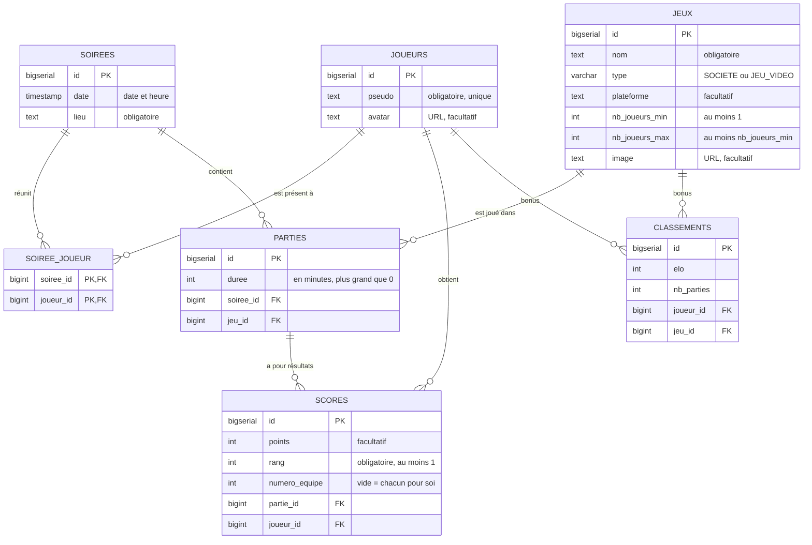

# Modèle de données – PlayNight

Ce document fixe le schéma de la base avant l'écriture des scripts SQL (`back-skeleton/initdb/`).
Il sert de référence commune pour le SQL, les entités JPA et les DTO.

## Schéma



## Tables

### `joueurs`
| Colonne | Type SQL | Type Java | Contraintes |
|---|---|---|---|
| id | BIGSERIAL | Long | clé primaire |
| pseudo | TEXT | String | obligatoire, unique |
| avatar | TEXT | String | facultatif (URL d'une image) |

### `jeux`
| Colonne | Type SQL | Type Java | Contraintes |
|---|---|---|---|
| id | BIGSERIAL | Long | clé primaire |
| nom | TEXT | String | obligatoire |
| type | VARCHAR | enum `TypeJeu` | obligatoire, `SOCIETE` ou `JEU_VIDEO` (`@Enumerated(EnumType.STRING)`) |
| plateforme | TEXT | String | facultatif (surtout pour les jeux vidéo : PC, Switch, PS5…) |
| nb_joueurs_min | INT | Integer | obligatoire, au moins 1 |
| nb_joueurs_max | INT | Integer | obligatoire, au moins `nb_joueurs_min` |
| image | TEXT | String | facultatif (URL) |

### `soirees`
| Colonne | Type SQL | Type Java | Contraintes |
|---|---|---|---|
| id | BIGSERIAL | Long | clé primaire |
| date | TIMESTAMP | LocalDateTime | obligatoire (date et heure) |
| lieu | TEXT | String | obligatoire |

### `soiree_joueur` (joueurs présents à une soirée)
Table de liaison de la relation ManyToMany `Soiree` ↔ `Joueur`. Il n'y a pas d'entité Java pour cette table : elle est gérée par `@JoinTable`, comme `student_course` dans l'exemple.

| Colonne | Type SQL | Contraintes |
|---|---|---|
| soiree_id | BIGINT | clé étrangère vers `soirees` |
| joueur_id | BIGINT | clé étrangère vers `joueurs` |

Clé primaire : le couple (`soiree_id`, `joueur_id`). Un joueur ne peut donc pas être présent deux fois à la même soirée.

### `parties`
| Colonne | Type SQL | Type Java | Contraintes |
|---|---|---|---|
| id | BIGSERIAL | Long | clé primaire |
| duree | INT | Integer | obligatoire, en minutes, plus grand que 0 |
| soiree_id | BIGINT | `Soiree` (ManyToOne) | obligatoire |
| jeu_id | BIGINT | `Jeu` (ManyToOne) | obligatoire |

### `scores` (entité d'association `Partie` ↔ `Joueur`)
| Colonne | Type SQL | Type Java | Contraintes |
|---|---|---|---|
| id | BIGSERIAL | Long | clé primaire |
| points | INT | Integer | facultatif (certains jeux n'ont qu'un classement) |
| rang | INT | Integer | obligatoire, au moins 1 (1 = vainqueur) |
| numero_equipe | INT | Integer | facultatif : vide pour une partie en chacun pour soi |
| partie_id | BIGINT | `Partie` (ManyToOne) | obligatoire |
| joueur_id | BIGINT | `Joueur` (ManyToOne) | obligatoire |

Le couple (`partie_id`, `joueur_id`) est unique : un joueur n'a qu'un seul score par partie.

**Parties en équipe** : chaque joueur a sa ligne, avec son `numero_equipe`. Les membres d'une même équipe ont le même rang (et les mêmes points). Exemple pour un 2v2 gagné par l'équipe 1 :

| joueur | numero_equipe | rang | points |
|---|---|---|---|
| Léa | 1 | 1 | 4 |
| Max | 1 | 1 | 4 |
| Tom | 2 | 2 | 2 |
| Sam | 2 | 2 | 2 |

### `classements` (bonus 3 : Elo par jeu)
| Colonne | Type SQL | Type Java | Contraintes |
|---|---|---|---|
| id | BIGSERIAL | Long | clé primaire |
| elo | INT | Integer | obligatoire, 1000 au départ |
| nb_parties | INT | Integer | obligatoire, 0 au départ |
| joueur_id | BIGINT | `Joueur` (ManyToOne) | obligatoire |
| jeu_id | BIGINT | `Jeu` (ManyToOne) | obligatoire |

Le couple (`joueur_id`, `jeu_id`) est unique : un seul classement par joueur et par jeu.

## Règles de suppression

| On supprime… | Conséquence | En SQL |
|---|---|---|
| une soirée | ses parties, leurs scores et la liste des présents sont supprimés aussi | `ON DELETE CASCADE` sur `parties.soiree_id`, `scores.partie_id`, `soiree_joueur.soiree_id` |
| une partie | ses scores sont supprimés aussi | `ON DELETE CASCADE` sur `scores.partie_id` |
| un jeu déjà joué | **refusé** (sinon l'historique serait faussé) | pas de cascade sur `parties.jeu_id` |
| un joueur qui a des scores | **refusé** | pas de cascade sur `scores.joueur_id` |
| un joueur sans score | accepté ; il est retiré des listes de présents | `ON DELETE CASCADE` sur `soiree_joueur.joueur_id` |

## Choix techniques

- **Identifiants en `BIGSERIAL` côté SQL et `Long` côté Java.** Le squelette utilise `SERIAL` (entier 32 bits) avec des `Long` (64 bits). Ça passe tant que Hibernate ne vérifie pas le schéma, mais pas avec `spring.jpa.hibernate.ddl-auto=validate`.
- **Noms** : tables au pluriel et en `snake_case` (`nb_joueurs_min`), attributs Java en `camelCase` (`nbJoueursMin`), avec `@Column(name = "...")` quand les deux diffèrent.
- **Type de jeu** : enum Java `TypeJeu { SOCIETE, JEU_VIDEO }`, stocké sous forme de texte en base.

## Classement Elo (ticket #24)

`classements` est une projection de l'historique, jamais une source de résultats.
`GET /jeux/{id}/classement` renvoie `joueurId`, `pseudo`, `avatar`, `elo`,
`nbParties` et `rang`, triés par Elo décroissant puis pseudo et identifiant.
Les ex aequo partagent un rang (1, 2, 2, 4). Jeu absent : 404 ; historique
sans résultat exploitable : 200 et `[]`. Les classements par victoires
(bonus #16 et page Joueurs) restent disponibles sans changement.

### Calcul

- Chaque couple joueur/jeu commence à **1000**, avec **0 partie** ; seules les
  personnes ayant un résultat exploitable sont persistées et affichées.
- **K = 32**. Pour deux adversaires A et B :
  `E(A,B) = 1 / (1 + 10^((R_B - R_A) / 400))`.
  Le résultat réel `S(A,B)` vaut 1 si A a un meilleur rang, 0 en cas de défaite,
  et 0,5 si les rangs sont égaux. Les points bruts ne servent pas à départager.
- En multijoueur à N adversaires, `delta_A = 32/(N-1) * somme_B(S(A,B)-E(A,B))`.
  Chaque joueur affronte virtuellement tous les autres ; la moyenne conserve
  l'échelle de K indépendamment du nombre de participants.
- En équipe, chaque numéro définit un adversaire dont l'Elo est la moyenne
  arithmétique des Elo de ses membres avant la partie. Tous les membres doivent
  avoir le même rang. Chaque membre reçoit la même variation d'équipe, même
  lorsque les effectifs diffèrent ; le total des Elo individuels n'est donc pas
  nécessairement conservé avec des équipes de tailles différentes.
- Tous les résultats attendus sont calculés avec les Elo **avant** la partie.
  La variation est arrondie à l'entier le plus proche (demi-entiers à l'opposé
  de zéro), puis appliquée une seule fois à chaque joueur. Les arrondis peuvent
  aussi introduire un petit écart de somme en multijoueur.
- Aucun calcul ni compteur pour une partie sans scores, un seul joueur, une
  seule équipe, un rang absent/invalide, un joueur dupliqué, des rangs d'équipe
  incohérents ou un mélange de scores avec et sans numéro d'équipe. Un vrai
  match nul (tous les rangs égaux) compte et peut ajuster des Elo différents.

### Recalcul et transactions

À chaque création, modification ou suppression de soirée, l'ensemble des jeux
est reconstruit depuis 1000 dans la même transaction. L'ordre est la date de
soirée croissante, puis son identifiant, puis l'identifiant de partie. Les
parties d'une même soirée suivent l'ordre de saisie ; leur recréation conserve
cet ordre. Une modification de date peut donc modifier la suite du classement.
Les anciens résultats, y compris ceux d'un jeu retiré d'une soirée, disparaissent
sans laisser d'Elo résiduel. Un recalcul identique ne double jamais les compteurs.

Un verrou consultatif PostgreSQL transactionnel (`pg_advisory_xact_lock(240024)`)
est acquis **avant** les écritures de soirées et conservé jusqu'à la fin du
recalcul et du commit. Il sérialise ces écritures, y compris entre plusieurs
instances de l'API. Les lecteurs voient le classement précédent ou le nouveau
classement complet. Les modifications et suppressions sont flushées puis le
contexte JPA est vidé avant de relire les scores, pour éviter les anciennes
collections en cache. Toute erreur annule résultats et classement ensemble.

Le même recalcul est effectué au démarrage pour intégrer l'historique antérieur
à ce bonus. Les écritures SQL externes nécessitent un redémarrage de l'API et ne
doivent pas être faites concurremment aux écritures API. Le recalcul complet
privilégie la fiabilité pour le volume de PlayNight ; son coût croît avec
l'historique et bloque temporairement les autres écritures de soirées.

### Installation sans perte de données

Une base neuve exécute automatiquement `back-skeleton/initdb/3_CLASSEMENTS.sql`.
Sur une base existante, arrêter l'API puis, depuis `back-skeleton/`, appliquer
uniquement ce script avant de relancer l'API :

```sh
docker compose exec -T database sh -c 'psql -v ON_ERROR_STOP=1 -U "$POSTGRES_USER" -d "$POSTGRES_DB"' < initdb/3_CLASSEMENTS.sql
```

Le script est rejouable (`IF NOT EXISTS`), ajoute la table et son index sans
supprimer les tables, les données ou les volumes. Le redémarrage reconstruit
ensuite les Elo depuis les parties existantes. Les clés étrangères du classement
utilisent `ON DELETE CASCADE` : cette projection n'empêche pas la suppression
d'un joueur ou d'un jeu sans résultat, tandis que les contraintes de `scores`
et `parties` continuent à protéger l'historique.
